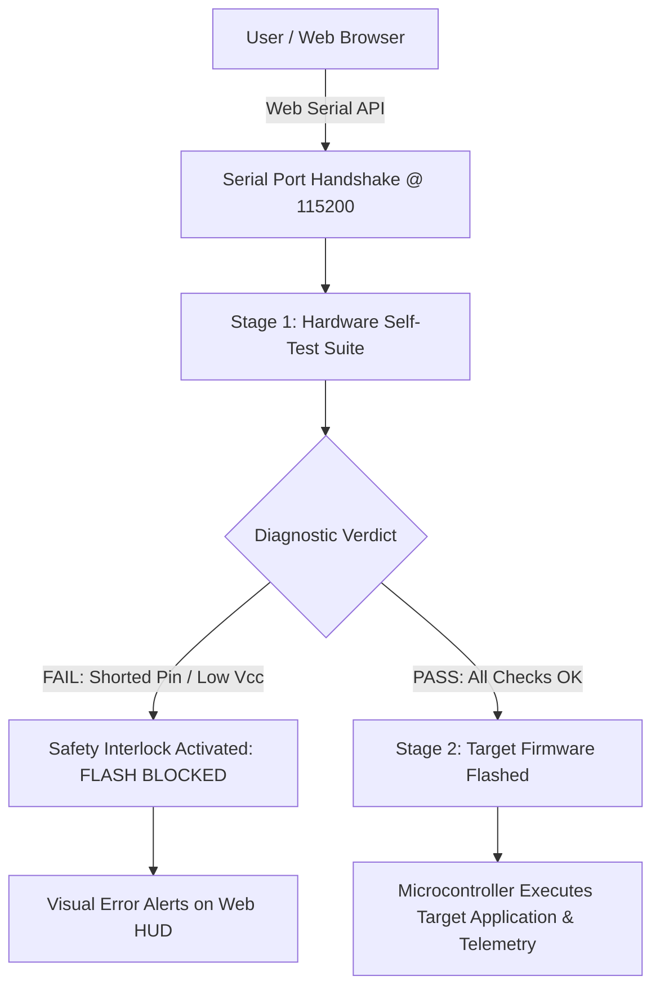
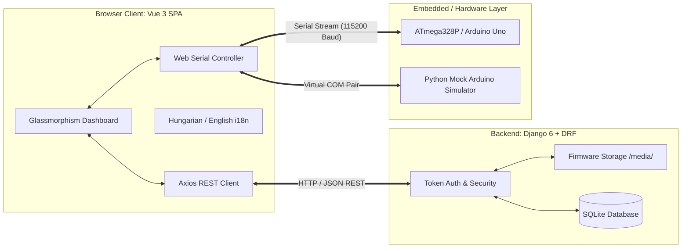
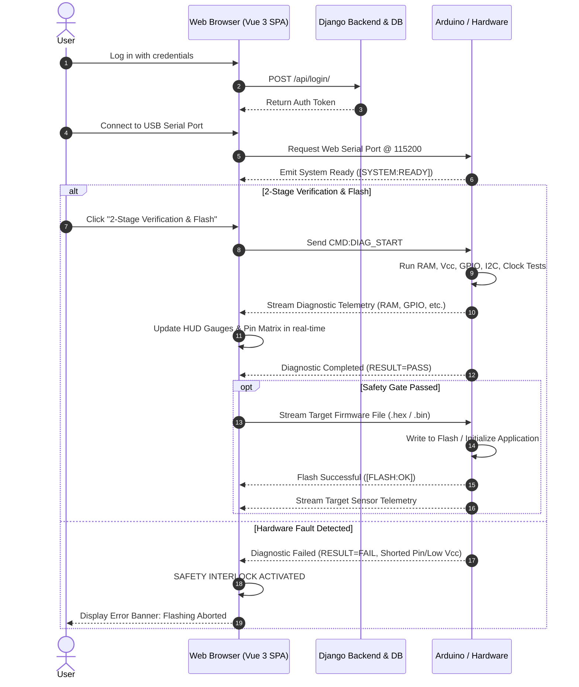

# Automated Microcontroller Diagnostic & Firmware Management System
## Comprehensive Project Overview & Architecture Documentation

---

## 1. Project Summary & Core Objective

The **Automated Microcontroller Diagnostic & Firmware Management System** (*Kétlépéses mikrokontroller diagnosztikai és firmware menedzsment rendszer*) is a full-stack, hardware-integrated web platform developed as a university thesis project. 

### The Core Problem
In traditional embedded systems workflows and educational laboratories, flashing compiled firmware (`.hex` or `.bin`) onto microcontrollers (such as Arduino Uno / ATmega328P) is done "blindly." Standard desktop uploaders (e.g., AVRDUDE, Arduino IDE) write machine code directly into flash memory without assessing the electrical and physical health of the connected target board. 
If the hardware suffers from:
- A shorted GPIO pin to ground or $V_{cc}$,
- An undervoltage condition on the power rail,
- Memory exhaustion ($SRAM$ stack/heap overflow),
- Floating pins or missing $I^2C$ pull-ups/peripherals,

blindly running the target firmware can cause undefined runtime crashes, corrupted data, or irreversible electrical damage to the microcontroller and attached sensors.

### The Solution: 2-Stage Verification & Flashing Architecture
This project introduces a **two-phase safety-critical upload pipeline**:
1. **Stage 1 (Hardware Diagnostic Self-Test HUD):** The microcontroller executes an automated self-diagnostic test suite verifying internal SRAM, supply voltage via internal bandgap reference, digital I/O pins, analog channels, $I^2C$ bus connectivity, and system clock stability. Telemetry is streamed in real time to a web-based Heads-Up Display (HUD).
2. **Stage 2 (Target Firmware Flashing & Runtime):** A **software safety interlock** evaluates the diagnostic verdict. Only if all hardware checks pass without fatal errors is the target firmware binary transmitted and executed.



---

## 2. Technology Stack & Technical Justifications

The system combines modern web standards, a secure REST backend, and embedded C++ firmware:

| Tier / Subsystem | Technologies Used | Key Responsibilities |
| :--- | :--- | :--- |
| **Frontend Web App** | **Vue 3** (Composition & Options API), **Vite**, **Vanilla CSS / Glassmorphism** | Responsive UI, real-time telemetry HUD, stepper workflow, i18n localization, serial state management. |
| **Hardware Bridge** | **Web Serial API** (`navigator.serial`) | Direct, zero-driver browser-to-microcontroller serial communication over USB COM ports. |
| **Backend API** | **Django 6**, **Django REST Framework (DRF)** | REST endpoints, token authentication, user isolation, firmware file uploads and storage. |
| **Database** | **SQLite 3** | Lightweight relational database for user accounts, credentials, and preset metadata. |
| **Embedded Firmware** | **C++ (AVR Core / Arduino)** | Native hardware self-diagnostics, bandgap voltage reading, $I^2C$ bus scanner, pin integrity checks. |
| **Hardware Simulator** | **Python 3 (`pyserial`)** | Virtual COM port emulator for testing, CI/CD, and demonstrations without physical hardware. |

### Why These Technologies Were Chosen

#### 1. Web Serial API instead of Desktop Bridge Software
- **Zero Installation Overhead:** Traditional web tools require users to install a native desktop daemon (e.g., Electron apps, Python background servers, or native WebSocket bridges) to communicate with serial ports. The standard Web Serial API allows the browser (Chrome, Edge, Opera) to directly acquire, read, and write to USB COM ports with native OS speed.
- **Portability:** Works identically across Windows, Linux, and macOS without compiling native platform binaries.

#### 2. Vue 3 + Vite
- **Reactivity & High-Frequency Streaming:** Incoming serial telemetry packets arrive at high frequency. Vue 3's fine-grained reactivity system dynamically updates the Pin Matrix, SRAM gauges, voltage meters, and terminal logs with minimal DOM reflow.
- **Vite Build Tooling:** Provides instantaneous Hot Module Replacement (HMR) and lightweight optimized production bundles.

#### 3. Django 6 & Django REST Framework (DRF)
- **Security & User Isolation:** Django provides battle-tested security out-of-the-box (CSRF protection, secure password hashing using PBKDF2 with SHA256). Token-based authentication (`rest_framework.authtoken`) ensures that each user's uploaded `.hex` files and presets are isolated and accessible only to their creator.
- **Robust Multi-part File Handling:** Easily manages binary/Intel HEX firmware file uploads and persists them in designated media directories.

#### 4. Native AVR C++ (No External Libraries)
- **Portability & Determinism:** The Stage 1 diagnostic runner (`diagnostic_runner.ino`) relies entirely on native AVR hardware registers and standard Arduino Core libraries (`Wire.h`). It requires zero external third-party dependencies, fitting comfortably inside the 32 KB Flash and 2 KB SRAM of an ATmega328P.

---

## 3. High-Level Architecture & Communication Protocols



### Serial Diagnostic Protocol Specification
The embedded firmware and web frontend communicate using a deterministic, human-readable ASCII tag protocol at **115,200 baud**:

- **Telemetry Format:** `[DIAG:<SUBSYSTEM>:<KEY>=<VAL>;...]`
- **Control Commands:**
  - `CMD:PING` $\rightarrow$ Responds with `[PONG] Diagnostic Runner Active`
  - `CMD:DIAG_START` $\rightarrow$ Initiates the Stage 1 full self-test suite
  - `CMD:SIM_FAULT` $\rightarrow$ Injects artificial faults (e.g. Pin 4 shorted, undervoltage) to test safety interlocks

#### Protocol Tag Breakdown:
| Diagnostic Tag | Parameters | Meaning / Action |
| :--- | :--- | :--- |
| `[DIAG:START]` | None | Notifies HUD that test sequence has started. Sets state to `RUNNING`. |
| `[DIAG:RAM:...]` | `FREE=<bytes>;TOTAL=<bytes>;STATUS=<OK\|WARN>` | Reports free stack-heap delta and SRAM memory status. |
| `[DIAG:VCC:...]` | `VOLTS=<float>;STATUS=<OK\|WARN>` | Reports internal power rail voltage measured via internal 1.1V bandgap. |
| `[DIAG:GPIO:...]` | `PIN=<2..13>;STATE=<OK\|SHORTED_GND\|PULLED_LOW>;STATUS=<OK\|FAIL>` | Reports individual digital pin pull-up and input integrity. |
| `[DIAG:ANALOG:...]` | `PIN=<A0..A5>;RAW=<0..1023>;STATUS=OK` | Reports raw ADC channel conversions. |
| `[DIAG:I2C:...]` | `SDA=OK;SCL=OK;DEVICES=<count>;STATUS=OK` | Reports $I^2C$ bus status. |
| `[DIAG:I2C_DEV:...]` | `ADDR=<hex>;STATUS=FOUND` | Emits address for each discovered peripheral (e.g., `0x68` MPU6050/RTC). |
| `[DIAG:CLOCK:...]` | `FREQ=16MHZ;TIMING_US=<us>;STATUS=OK` | Verifies system oscillator calibration. |
| `[DIAG:COMPLETE:...]`| `RESULT=<PASS\|FAIL>;CHECKS=<n>;FAILED=<m>` | Final diagnostic verdict triggering the safety interlock. |

---

## 4. Key Features & Functional Modules

### 1. User Authentication & Profile Security
- Token-authenticated REST API (`/api/register/`, `/api/login/`).
- Protected frontend routes (`/dashboard`) guarded by Vue Router `beforeEach` navigation hooks.
- Automatic session cleanup and token management via browser `localStorage`.

### 2. Firmware Preset Library & Cloud Storage
- Users can upload compiled `.hex` or `.bin` files with custom titles and hardware descriptions.
- Presets are saved in the Django media storage and indexed in SQLite.
- One-click loading of stored presets into the active flashing buffer.

### 3. Real-Time Diagnostic HUD & I/O Pin Matrix
- **SRAM Gauge:** Displays dynamically colored free memory bars (Green: $>500$ B, Amber: $>200$ B, Red: critical).
- **$V_{cc}$ Voltage Gauge:** Measures true rail voltage via ADC bandgap channel without external resistors.
- **Digital Pin Matrix (D2–D13):** Visual badges reflecting real-time state (`OK`, `TESTING`, `SHORTED_GND`, `PULLED_LOW`).
- **Analog Pin Monitor (A0–A5):** Raw ADC 10-bit integer telemetry ($0 - 1023$).
- **$I^2C$ Bus Scanner:** Automatically scans 7-bit addresses $0x01 - 0x7E$ and lists attached sensor addresses.
- **Clock Verification:** Microsecond timing delta check across delay loops.

### 4. Safety Interlock & Dual Flashing Modes
- **Mode 1: "2-Stage Verification & Flash" (Recommended):** Automatically triggers Stage 1 diagnostics, waits for the completion packet, evaluates health status, and only proceeds to flash Stage 2 if zero fatal faults are detected.
- **Mode 2: "Direct Flash":** Bypasses diagnostic checks for quick uploads or override scenarios.
- **Fault Injection Simulation:** Dedicated button (`CMD:SIM_FAULT`) to demonstrate safety interlock behavior during thesis evaluations.

### 5. Interactive Serial Terminal
- Integrated dark-themed serial terminal supporting real-time logging, autoscroll toggles, log clearing, and custom command transmission.

### 6. Full Bilingual Internationalization (i18n)
- Native reactive translation engine supporting Hungarian (`HU`) and English (`EN`).
- Dynamic language switching without full page reload, persisting user preferences.

### 7. Virtual Hardware Simulator (`mock_arduino.py`)
- Standalone Python script using `pyserial` to emulate an Arduino on virtual COM ports (e.g., `com0com` COM10 $\leftrightarrow$ COM11).
- Emulates Stage 1 diagnostics, simulated fault injection, Intel HEX EOF parsing, and simulated Stage 2 runtime telemetry stream.

---

## 5. Detailed End-to-End Workflow



---

## 6. Repository Directory Structure & File Map

```
SzakdolgozatProject/
│
├── SzakdolgozatProject/            # Django Root Project Configuration
│   ├── settings.py                 # Core settings, CORS, DRF TokenAuth, Media path
│   ├── urls.py                     # Root URL routing
│   ├── asgi.py & wsgi.py           # Application entry points
│
├── devices/                        # Django Device & Preset Management App
│   ├── models.py                   # Preset model (user, name, firmware_file, config_json)
│   ├── views.py                    # REST views: register_user, login_user, upload_preset, get_presets
│   ├── serializers.py              # PresetSerializer
│   └── urls.py                     # App routing (/api/register, /api/login, /api/upload, /api/presets)
│
├── api/                            # Auxiliary API App (healthchecks & modular extensions)
│   ├── views.py                    # API ping/test endpoint
│   └── urls.py                     # Routing for API endpoints
│
├── frontend/                       # Vue 3 Single Page Application (SPA)
│   ├── package.json                # NPM dependencies (vue 3.5+, vue-router, vite, axios)
│   ├── vite.config.js              # Vite bundler configuration
│   ├── index.html                  # HTML entry point with system fonts
│   └── src/
│       ├── main.js                 # Vue initialization and router registration
│       ├── App.vue                 # Root component: Sticky Glassmorphic Topbar & Language Switcher
│       ├── style.css               # Global theme tokens, scrollbars, resets
│       ├── router/index.js         # Client-side router with auth guards
│       ├── i18n/
│       │   ├── index.js            # Reactive translation helper (t function, setLanguage)
│       │   └── translations.js     # Bilingual dictionary (Hungarian & English)
│       └── components/
│           ├── Login.vue           # User login interface
│           ├── Register.vue        # User registration interface
│           └── Dashboard.vue       # Main Controller: Web Serial, HUD, Pin Matrix, Presets, Terminal
│
├── arduino/                        # Embedded C++ Firmware
│   └── diagnostic_runner/
│       └── diagnostic_runner.ino   # Stage 1 self-test firmware for ATmega328P / Arduino Uno
│
├── mock_arduino.py                 # Python Virtual Serial Hardware Simulator
├── db.sqlite3                      # SQLite Relational Database
├── manage.py                       # Django CLI management script
└── PROJECT_OVERVIEW.md             # This comprehensive architecture overview
```

---

## 7. How to Run & Test the Application

### 1. Start the Django Backend
```bash
# In the repository root:
python -m venv .venv
# Activate environment (Windows: .venv\Scripts\activate, Linux: source .venv/bin/activate)
pip install django djangorestframework django-cors-headers pyserial
python manage.py migrate
python manage.py runserver 127.0.0.1:8000
```

### 2. Start the Vue 3 Frontend
```bash
cd frontend
npm install
npm run dev
# The application will be accessible at http://localhost:5173
```

### 3. Run Hardware or Mock Simulation
- **Option A (Physical Arduino):**
  Open `arduino/diagnostic_runner/diagnostic_runner.ino` in the Arduino IDE and flash it to an Arduino Uno. Open the web app and connect to the Arduino's COM port.
- **Option B (Python Hardware Simulator):**
  Set up a virtual serial port pair (e.g. `COM10` $\leftrightarrow$ `COM11` using com0com or VSPE).
  ```bash
  python mock_arduino.py
  ```
  In the web app, connect to `COM10` at `115200` baud.

---

## 8. Summary of Benefits & Novelty

1. **Hardware Damage Prevention:** Protects microcontrollers and custom PCB shields from short circuits and supply instability before flashing user firmware.
2. **Platform Independence:** Runs entirely in modern web browsers via Web Serial API without requiring native OS installers.
3. **Transparent Visibility:** Real-time visual telemetry gives immediate insight into memory, electrical, and bus conditions.
4. **Cloud Preset Workflow:** Consolidates project firmwares, configuration presets, and flashing into a single unified workspace.
