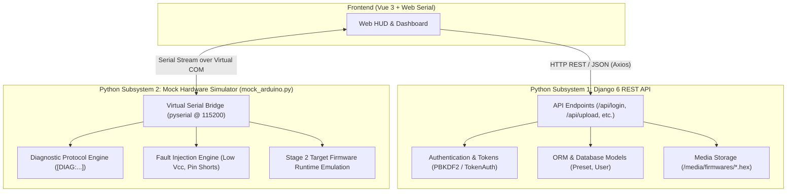
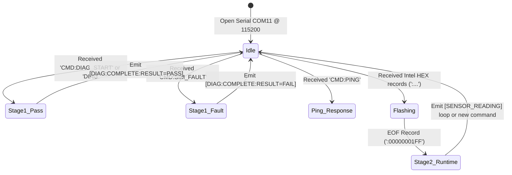

# Python Architecture & Role Breakdown

## 1. Executive Summary

In the **Automated Microcontroller Diagnostic & Firmware Management System**, Python operates in two distinct, high-impact subsystems:

1. **The Backend REST API & Persistence Engine** (powered by **Django 6** and **Django REST Framework**): Responsible for user authentication, security isolation, database operations (SQLite), firmware binary file management, and API endpoints.
2. **The Hardware Emulation & Testing Layer** (powered by **Python `pyserial`** in `mock_arduino.py`): A standalone desktop utility that emulates an Arduino board over virtual COM ports, enabling full end-to-end testing of Stage 1 diagnostics, fault injection, and Stage 2 firmware flashing without requiring physical microcontroller hardware.



---

## 2. Subsystem 1: Django REST API & Backend Services

The backend handles multi-tenant user accounts, security tokens, and firmware preset storage.

### A. Core Python Files & Responsibilities

| File Path | Role | Key Logic & Mechanisms |
| :--- | :--- | :--- |
| [`SzakdolgozatProject/settings.py`](file:///d:/PythonProjects/SzakdolgozatProject/SzakdolgozatProject/settings.py) | **Global Configuration** | Configures installed apps (`rest_framework`, `devices`, `corsheaders`, `authtoken`), SQLite database path, `CORS_ALLOWED_ORIGINS` (ports 5173 for Vite), token authentication classes, and media storage (`/media/`). |
| [`SzakdolgozatProject/urls.py`](file:///d:/PythonProjects/SzakdolgozatProject/SzakdolgozatProject/urls.py) | **Root URL Dispatcher** | Routes `/admin/`, `/api/` endpoints, and attaches `static(settings.MEDIA_URL, document_root=settings.MEDIA_ROOT)` for direct firmware binary downloads. |
| [`devices/models.py`](file:///d:/PythonProjects/SzakdolgozatProject/devices/models.py) | **Database ORM Models** | Defines the [`Preset`](file:///d:/PythonProjects/SzakdolgozatProject/devices/models.py#L4-L18) model (user relationship, file storage, JSON configurations). |
| [`devices/serializers.py`](file:///d:/PythonProjects/SzakdolgozatProject/devices/serializers.py) | **DRF Serializers** | [`PresetSerializer`](file:///d:/PythonProjects/SzakdolgozatProject/devices/serializers.py#L4-L12) transforms database objects into JSON and validates multi-part file uploads. |
| [`devices/views.py`](file:///d:/PythonProjects/SzakdolgozatProject/devices/views.py) | **API Business Logic** | Implements user registration, login token generation, preset upload with JSON normalization, and filtered preset retrieval. |
| [`devices/urls.py`](file:///d:/PythonProjects/SzakdolgozatProject/devices/urls.py) | **Device App Routing** | Maps endpoints for auth and preset management (`/api/register/`, `/api/login/`, `/api/upload/`, `/api/presets/`). |
| [`api/views.py`](file:///d:/PythonProjects/SzakdolgozatProject/api/views.py) / [`api/urls.py`](file:///d:/PythonProjects/SzakdolgozatProject/api/urls.py) | **Health Check API** | Simple test endpoint ([`test_api`](file:///d:/PythonProjects/SzakdolgozatProject/api/views.py#L8-L10)) for verifying API server availability. |
| [`manage.py`](file:///d:/PythonProjects/SzakdolgozatProject/manage.py) | **Django CLI Interface** | Entrypoint for running migrations, creating superusers, and launching development servers (`runserver`). |

---

### B. Detailed REST Endpoints Handled by Python

#### 1. User Registration: `POST /api/register/`
- **Function:** [`register_user`](file:///d:/PythonProjects/SzakdolgozatProject/devices/views.py#L43-L55)
- **What Python does:**
  - Reads `username`, `password`, and optional `email` from the request body.
  - Calls Django's built-in `User.objects.create_user()` which securely hashes passwords using **PBKDF2 with SHA256**.
  - Returns `201 Created` on success, or `400 Bad Request` if the user already exists.

#### 2. User Authentication: `POST /api/login/`
- **Function:** [`login_user`](file:///d:/PythonProjects/SzakdolgozatProject/devices/views.py#L57-L68)
- **What Python does:**
  - Authenticates credentials via `django.contrib.auth.authenticate()`.
  - Generates or retrieves a persistent API token via `Token.objects.get_or_create(user=user)`.
  - Returns `{ "token": "<hex_key>", "message": "Sikeres belépés!" }` with HTTP `200 OK`, or `401 Unauthorized` on failure.

#### 3. Upload Firmware Preset: `POST /api/upload/`
- **Function:** [`upload_preset`](file:///d:/PythonProjects/SzakdolgozatProject/devices/views.py#L15-L33)
- **Permissions:** `[IsAuthenticated]` (Enforced via DRF `TokenAuthentication`).
- **What Python does:**
  - Parses multi-part form data containing the firmware file (`.hex` or `.bin`), name, description, and optional diagnostic parameters.
  - Sanitizes `config_json` (converts raw strings into valid Python dictionaries).
  - Validates through [`PresetSerializer`](file:///d:/PythonProjects/SzakdolgozatProject/devices/serializers.py#L4-L12).
  - Saves the file into `media/firmwares/` and saves the database row associated with `request.user`.

#### 4. List User Presets: `GET /api/presets/`
- **Function:** [`get_presets`](file:///d:/PythonProjects/SzakdolgozatProject/devices/views.py#L35-L41)
- **Permissions:** `[IsAuthenticated]`
- **What Python does:**
  - Enforces user isolation: queries only presets where `user=request.user` (`Preset.objects.filter(user=request.user).order_by('-created_at')`).
  - Serializes the list to JSON including file URLs (`/media/firmwares/...`) for the frontend to fetch.

---

### C. Database Model Managed by Python ORM

Defined in [`devices/models.py`](file:///d:/PythonProjects/SzakdolgozatProject/devices/models.py):

```python
class Preset(models.Model):
    user = models.ForeignKey(User, on_delete=models.CASCADE, related_name='presets')
    name = models.CharField(max_length=100)
    description = models.TextField(blank=True)
    firmware_file = models.FileField(upload_to='firmwares/')
    config_json = models.JSONField(help_text='I/O pinek és opcionális diagnosztikai paraméterek', default=dict, blank=True)
    created_at = models.DateTimeField(auto_now_add=True)
    last_updated_at = models.DateTimeField(auto_now=True)
```

- **User Isolation:** `ForeignKey(User)` ensures users only see and flash their own presets.
- **File Management:** `FileField` automatically routes stored firmware into `media/firmwares/`.
- **Flexible Configuration:** `JSONField` allows storing dynamic pin setups and test configurations per preset.

---

## 3. Subsystem 2: Mock Hardware Simulator (`mock_arduino.py`)

[`mock_arduino.py`](file:///d:/PythonProjects/SzakdolgozatProject/mock_arduino.py) is a complete Python-based hardware emulation script for local development and demonstration.



### Key Capabilities of `mock_arduino.py`:

1. **Virtual Serial Connection (`pyserial`):**
   - Connects to a virtual COM port pair (e.g. `COM11` paired with `COM10` via com0com or VSPE) at `115200` baud.
   - Buffers incoming serial chunks and cleanly splits by newline (`\n`), handling reconnects and glued commands.

2. **Stage 1 Diagnostic Protocol Emulation (`run_diagnostics()`):**
   - Emits formatted telemetry lines matching the exact protocol used by the physical C++ firmware:
     - **RAM Check:** `[DIAG:RAM:FREE=1648;TOTAL=2048;STATUS=OK]`
     - **Vcc Rail:** `[DIAG:VCC:VOLTS=5.04;STATUS=OK]`
     - **Digital Pins:** `[DIAG:GPIO:PIN=2..13;STATE=OK;STATUS=OK]`
     - **Analog Channels:** `[DIAG:ANALOG:PIN=A0..A5;RAW=...;STATUS=OK]`
     - **I2C Bus Scanner:** `[DIAG:I2C:SDA=OK;SCL=OK;DEVICES=1;STATUS=OK]` + `[DIAG:I2C_DEV:ADDR=0x68;STATUS=FOUND]`
     - **Clock Calibration:** `[DIAG:CLOCK:FREQ=16MHZ;TIMING_US=10012;STATUS=OK]`
     - **Verdict Packet:** `[DIAG:COMPLETE:RESULT=PASS;CHECKS=21;FAILED=0]`

3. **Fault Injection Engine (`simulate_fault=True`):**
   - When receiving `CMD:SIM_FAULT`, intentionally broadcasts failure telemetry:
     - Low SRAM warning (`FREE=120`, `STATUS=WARN`)
     - Undervoltage failure (`VOLTS=3.12`, `STATUS=FAIL`)
     - Shorted pin fault (`PIN=4`, `STATE=SHORTED_GND`, `STATUS=FAIL`)
     - Failed verdict packet: `[DIAG:COMPLETE:RESULT=FAIL;CHECKS=21;FAILED=2;ERROR=PIN_4_SHORTED_AND_LOW_VCC]`
   - This allows testing the Vue frontend's safety interlock to prove that flashing is blocked when faults occur.

4. **Intel HEX Flashing & Stage 2 Runtime Simulator:**
   - Detects incoming Intel HEX records (starting with `:`).
   - Upon encountering the Intel HEX End-Of-File record (`:00000001FF`), responds with `[FLASH:OK]` and enters `run_target_firmware_loop()`.
   - Emulates active sensor runtime by streaming periodic temperature, humidity, and pin state cycles (`[SENSOR_READING] Cycle #001...`).

---

## 4. Architectural Separation: What Python Handles vs Other Layers

| Responsibility | Handled by Python? | Layer / Technology |
| :--- | :---: | :--- |
| **User Accounts & Password Hashing** | ✅ **Yes** | Python / Django Auth (`PBKDF2`) |
| **Session & Token Authentication** | ✅ **Yes** | Python / DRF (`TokenAuthentication`) |
| **Firmware Preset Database CRUD** | ✅ **Yes** | Python / Django ORM + SQLite |
| **Firmware File Storage on Disk** | ✅ **Yes** | Python / Django `FileField` (`/media/firmwares/`) |
| **Hardware Emulation & Testing** | ✅ **Yes** | Python / `pyserial` (`mock_arduino.py`) |
| **Simulated Fault Injection** | ✅ **Yes** | Python (`mock_arduino.py`) |
| **Direct Browser-to-Hardware Serial** | ❌ **No** | Frontend JavaScript (`Web Serial API`) |
| **HUD Visualization & Pin Matrix UI** | ❌ **No** | Frontend / Vue 3 Composition API |
| **Physical Pin Toggling & ADC Reads** | ❌ **No** | Embedded C++ (`diagnostic_runner.ino` on ATmega328P) |
| **On-Chip I2C Hardware Scanning** | ❌ **No** | Embedded C++ (`Wire.h` / AVR Registers) |

---

## 5. Summary

Python in this project is the **backbone for cloud storage, security, and developer emulation**:
- It ensures that users can securely authenticate and store their compiled firmware presets and hardware configurations.
- It provides a full virtual microcontroller simulator so the application can be developed, tested, and demonstrated without needing physical hardware attached.
